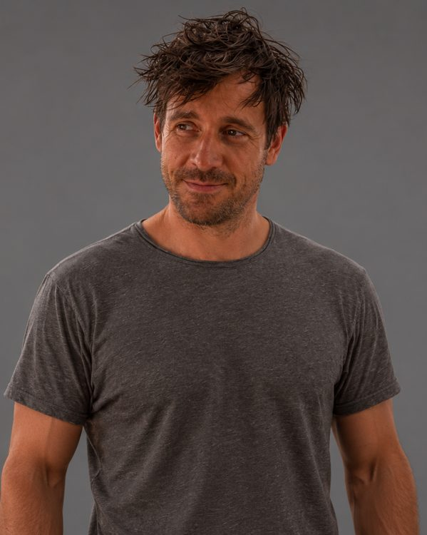
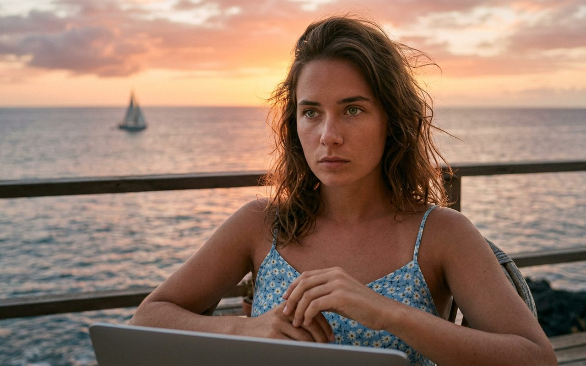
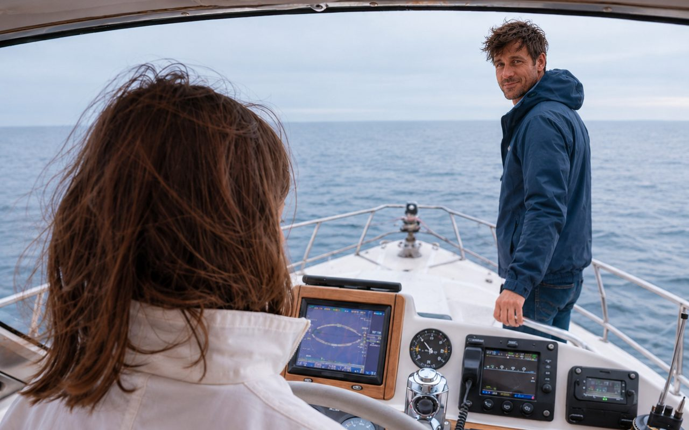
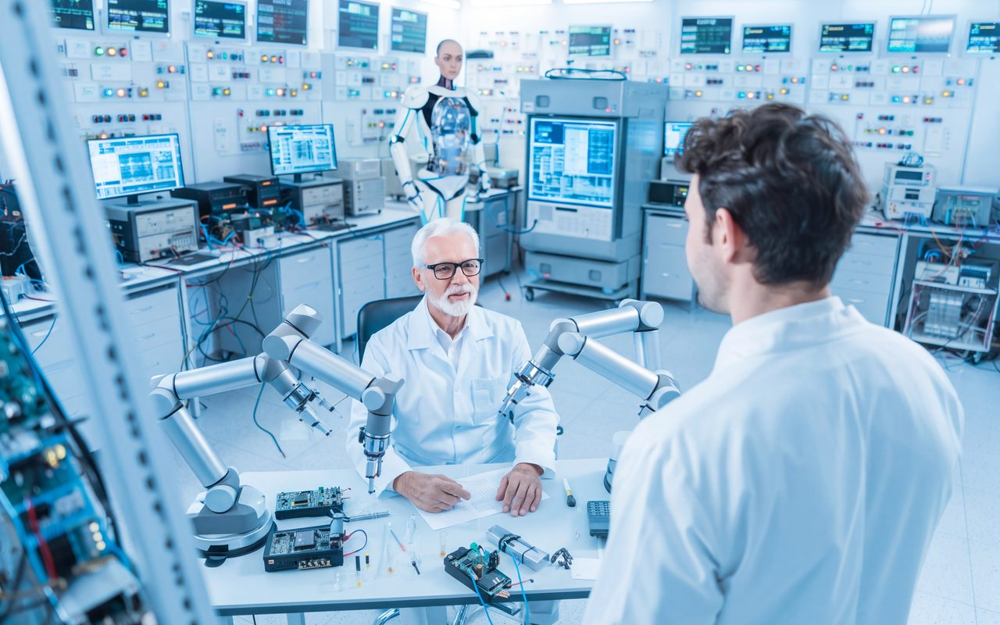

If you record everything about a person — will they wake up as themselves?

Claire is twenty-eight, a programmer living on Key West, where every evening the whole island sees the sun off. Her father, the captain of a fishing yacht, called her one morning before heading out to sea, and she didn’t pick up. From his messages and voice notes she put together a digital Silver — and realized it wasn’t enough. Now she records herself every day, so that what remains of her is not a cap on a hook, but herself.

Below are both episodes of the film. The full texts of both episodes and an essay on the film’s symbolism are <a href="#texts">at the end of the page</a>.

  <figure><figcaption><b>Claire</b>Twenty-eight, a programmer. Her father called her Skipper.</figcaption></figure>
  <figure><figcaption><b>Tom</b>Her father; ran the fishing yacht <em>Margaret</em> for thirty years. To his daughter, Silver.</figcaption></figure>
  <figure><figcaption><b>Jake</b>A mechanic from the next dock. Doesn’t like talking about serious things.</figcaption></figure>

## The Film

<h3>I Will Wake Up as Myself. Episode 1: The Missed Call</h3>

  
  

A film about a young woman from Key West who, after her father’s death, begins by chance to record her life — day after day, in the hope of one day continuing it. She believes that if you record everything about a person, they will wake up as themselves. A story about the dream of transhumanism — mind uploading and digital immortality — and about what actually remains of a person.

Based on the core ideas of the book «Project Causa Sui: A Foundation for Transhumanism» by Igor Shakhanov.

<iframe src="https://www.youtube-nocookie.com/embed/-2jqFcw3fn4" title="I Will Wake Up as Myself. Episode 1: The Missed Call" allow="accelerometer; autoplay; clipboard-write; encrypted-media; gyroscope; picture-in-picture; web-share" referrerpolicy="strict-origin-when-cross-origin" allowfullscreen loading="lazy"></iframe>

18 minutes · English subtitles available · <a href="https://youtu.be/-2jqFcw3fn4">watch on YouTube</a>

<h3>I Will Wake Up as Myself. Episode 2</h3>

  
  

A hurricane destroys part of the records. Beside her is a man who thinks nothing needs to be written down. Ahead lie twenty years of life and a conversation with her own copy. A hundred years later, Claire’s archive reaches two researchers — and it is up to them what to do with it. What is the difference between a copy and a person, and will the one who recorded herself completely wake up?

Based on the core ideas of the book «Project Causa Sui: A Foundation for Transhumanism» by Igor Shakhanov.

<iframe src="https://www.youtube-nocookie.com/embed/OV1mDFEXqJ8" title="I Will Wake Up as Myself. Episode 2" allow="accelerometer; autoplay; clipboard-write; encrypted-media; gyroscope; picture-in-picture; web-share" referrerpolicy="strict-origin-when-cross-origin" allowfullscreen loading="lazy"></iframe>

22 minutes · English subtitles available · <a href="https://youtu.be/OV1mDFEXqJ8">watch on YouTube</a>

Both episodes on YouTube: <a href="https://www.youtube.com/@IgorShakhanovFilm">@IgorShakhanovFilm</a>. The original Russian version is on the <a href="/articles/ya-obyazatelno-prosnus-soboy/">Russian page</a>.

## Film texts
{: #texts}

The texts of both episodes were written for voice-over narration. Here is the beginning of episode one.

Someday — perhaps a hundred years from now — someone will open their eyes and say: “My name is Claire. I was born on Key West. My father called me Skipper.”

She will remember every one of my sunsets. Every one of my mistakes. Every book my father read to me at bedtime.

I will wake up as myself. I’m sure of it.

At least… I was sure.

It all began with a phone call I didn’t pick up.

* * *

Every evening on Key West the same thing happens. Around seven, people come down to the water and watch the sun sink into the ocean. Tourists film the sunset on their phones. Locals just stand there. Some people applaud when the last edge of the sun disappears — as if it had done something special.

But it has simply gone. And tomorrow it will come back. The sun is allowed to.

* * *

My name is Claire. I’m twenty-eight. I’m a programmer; I write code for a company three thousand miles from here, and I have never once been to their office. I don’t need to.

My groceries are delivered to the door. My school friends scattered long ago — to Miami, to Atlanta, one to London. We like each other’s posts. I walk to the waterfront for the sunset alone, and that suits me.

I used to tell myself I had a quiet life. Now I think I simply arranged it that way — so that it would never ask anything of me.

I live in the house where I grew up. Everything here smells of salt and engine oil. The oil is because of my father.

<a href="/articles/i-will-wake-up-as-myself-text/">Full text of episode one →</a>

<a href="/articles/i-will-wake-up-as-myself-text-2/">Full text of episode two →</a>

<a href="/articles/i-will-wake-up-as-myself-symbolism/">Symbolism in the film: what lies behind the spark plugs, the notebook and the hurricane →</a>

---

© 2026 Igor Shakhanov. Story and script: Igor Shakhanov. Translated from the Russian. Made with Claude (Anthropic), ChatGPT (OpenAI), Adobe Firefly, ElevenLabs; sound — Pixabay.

