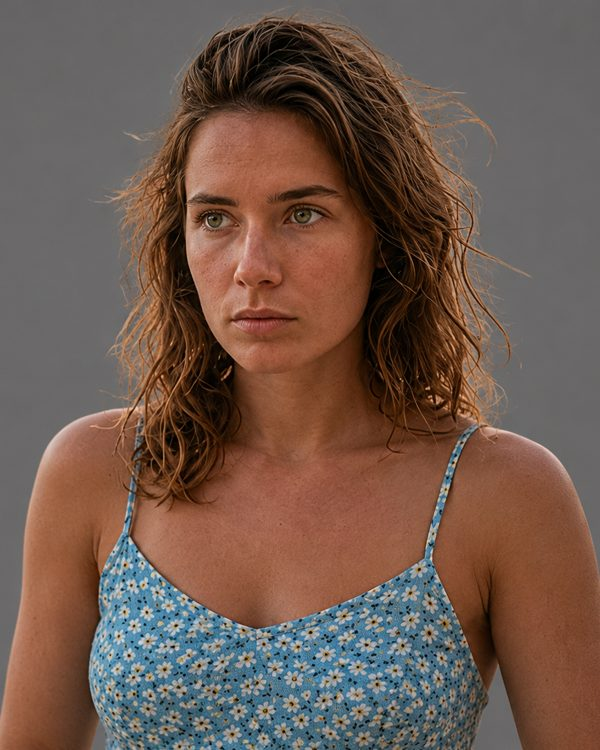
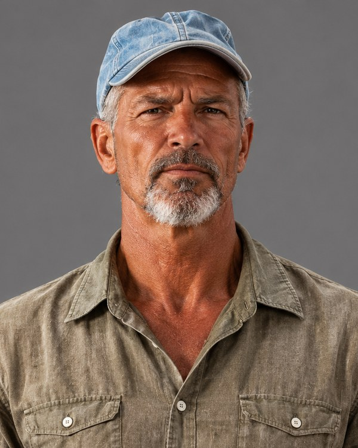
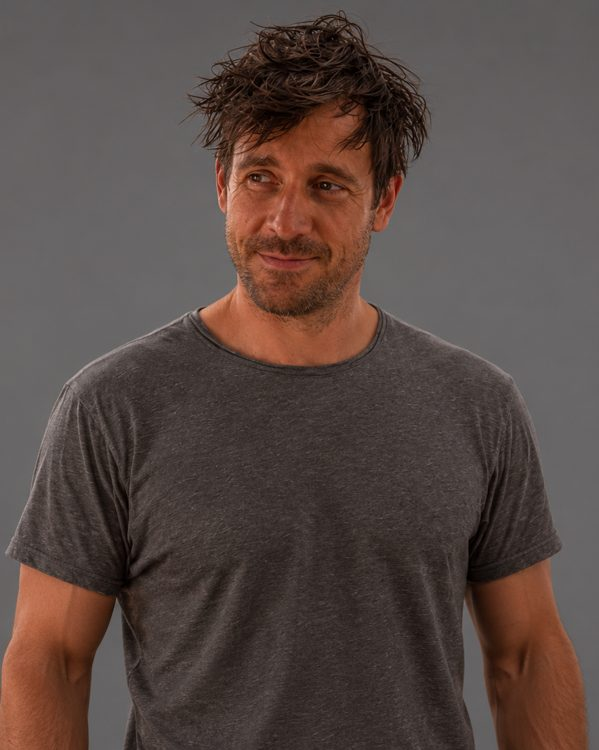
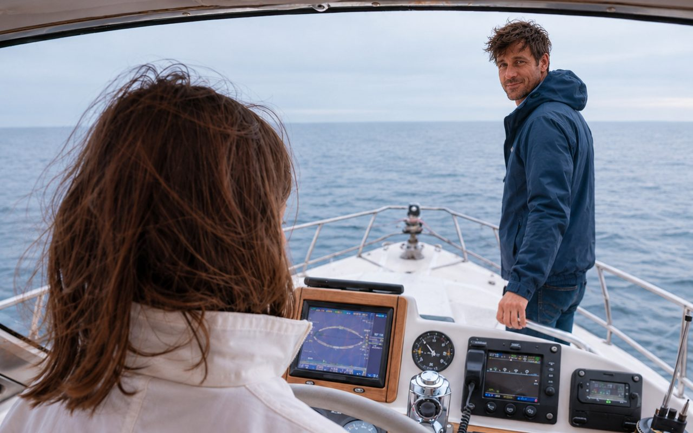
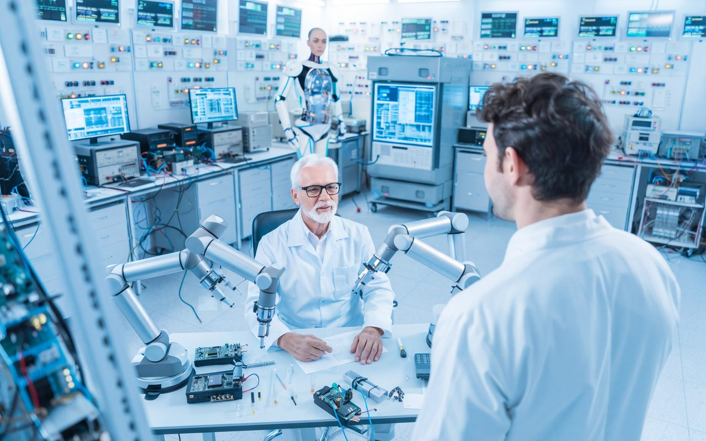

Если записать о человеке всё — проснётся ли он собой?

Клэр двадцать восемь лет, она программист и живёт на Кей Весте, где каждый вечер весь остров провожает солнце. Её отец, капитан рыболовной яхты, однажды утром позвонил ей перед выходом в море, а она не взяла трубку. Из его сообщений и голосовых она собрала цифрового Сильвера — и поняла, что этого мало. Теперь она каждый день записывает себя: чтобы от неё осталась не кепка на крючке, а она сама.

Ниже — обе серии фильма. Полные тексты обеих серий — <a href="#teksty">в конце страницы</a>.

  <figure><figcaption><b>Клэр</b>Двадцать восемь лет, программист. Отец звал её шкипером.</figcaption></figure>
  <figure><figcaption><b>Том</b>Её отец, тридцать лет водил рыболовную яхту «Маргарет». Для дочери — Сильвер.</figcaption></figure>
  <figure><figcaption><b>Джейк</b>Механик с соседнего причала. Не любит говорить о серьёзном.</figcaption></figure>

## Фильм

<h3>Я обязательно проснусь собой. Серия 1</h3>

  
  

Фильм о молодой девушке с Кей Веста, которая после гибели отца по воле случая начинает записывать свою жизнь — день за днём, в надежде однажды её продолжить. Она верит: если записать о человеке всё, он проснётся собой. Сериал о мечте трансгуманизма — загрузке сознания и цифровом бессмертии — и о том, что на самом деле остаётся от человека.

Сюжет опирается на основные положения книги Игоря Шаханова (Igor Shakhanov) «Project Causa Sui: A Foundation for Transhumanism».

<iframe src="https://dzen.ru/embed/oR0bxlMgRAAA?from_block=partner&from=zen&mute=0&autoplay=0&tv=0" title="Я обязательно проснусь собой. Серия 1" allow="autoplay; fullscreen; accelerometer; gyroscope; picture-in-picture; encrypted-media" allowfullscreen loading="lazy"></iframe>

18 минут · <a href="https://dzen.ru/video/watch/6b06da321991372a3932c3e4">смотреть на Дзене</a>

<h3>Я обязательно проснусь собой. Серия 2</h3>

  
  

Ураган уничтожает часть записей. Рядом человек, который считает, что записывать ничего не нужно. Впереди двадцать лет жизни и разговор с собственной копией. Через сто лет архив Клэр попадает к двум исследователям — и им решать, что с ним делать. Чем копия отличается от человека и проснётся ли тот, кто записал себя целиком?

Сюжет опирается на основные положения книги Игоря Шаханова (Igor Shakhanov) «Project Causa Sui: A Foundation for Transhumanism».

<iframe src="https://dzen.ru/embed/oR0bIrcgRAAA?from_block=partner&from=zen&mute=0&autoplay=0&tv=0" title="Я обязательно проснусь собой. Серия 2" allow="autoplay; fullscreen; accelerometer; gyroscope; picture-in-picture; encrypted-media" allowfullscreen loading="lazy"></iframe>

21 минута · <a href="https://dzen.ru/video/watch/6b06e1bf412ff90ddd4f71c1">смотреть на Дзене</a>

## Тексты фильма
{: #teksty}

Тексты обеих серий написаны для закадрового голоса. Вот начало первой серии.

Однажды — может быть, через сто лет — кто-то откроет глаза и скажет: «Меня зовут Клэр. Я родилась на Кей Вест. Мой отец звал меня шкипером».

Она будет помнить каждый мой закат. Каждую мою ошибку. Каждую книгу, которую отец читал мне на ночь.

Я обязательно проснусь собой. Я в этом уверена.

По крайней мере, была уверена.

А началось всё с телефонного звонка, который я не взяла.

* * *

Каждый вечер на Кей Вест происходит одно и то же. Около семи вечера люди выходят к воде и смотрят, как солнце погружается в океан. Туристы снимают закат на телефоны. Местные просто стоят. Кто-то аплодирует, когда последний край солнца исчезает, — будто оно сделало что-то особенное.

А оно просто ушло. И завтра вернётся. Солнцу можно.

* * *

Меня зовут Клэр. Мне двадцать восемь. Я программист, пишу код для компании, которая находится в трёх тысячах миль отсюда, и ни разу не была в их офисе. Мне не нужно.

Продукты мне привозят к двери. Подруги из школы давно разъехались — в Майами, в Атланту, одна в Лондон. Мы ставим друг другу лайки. На набережную к закату я хожу одна, и мне так удобно.

Я говорила себе, что у меня спокойная жизнь. Теперь я думаю, что я её просто так устроила — чтобы она ничего от меня не требовала.

Я живу в доме, где выросла. Здесь всё пахнет солью и машинным маслом. Маслом — из-за отца.

<a href="/articles/ya-obyazatelno-prosnus-soboy-tekst/">Полный текст первой серии →</a>

<a href="/articles/ya-obyazatelno-prosnus-soboy-tekst-2/">Полный текст второй серии →</a>

---

© 2026 Игорь Шаханов (Igor Shakhanov). Текст и сценарий: Игорь Шаханов. Фильм сделан с помощью Claude (Anthropic), ChatGPT (OpenAI), Adobe Firefly, ElevenLabs; звуки — Pixabay.

